# Tutorial: Interfaz Principal de Guali Tutor en Android (Android Studio, Java)

Este tutorial explica paso a paso cómo crear el **front end** de una aplicación móvil Android con los elementos de la sección **"Interfaz Principal"**: barra de menú, título de la lección activa, panel de la lección activa, editor de código, botones de acción (Compilar y Ejecutar) y panel de consola.

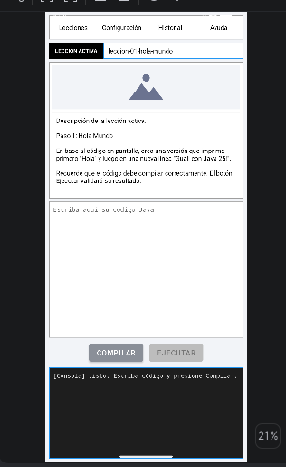

## Índice
1. [Qué vamos a construir](#1-qué-vamos-a-construir)
2. [Prerrequisitos y software necesario](#2-prerrequisitos-y-software-necesario)
3. [Instalación de Android Studio](#3-instalación-de-android-studio)
4. [Crear el proyecto](#4-crear-el-proyecto)
5. [Textos, colores y tema](#5-textos-colores-y-tema)
6. [Recursos gráficos (drawables)](#6-recursos-gráficos-drawables)
7. [Diseño de la interfaz (activity_main.xml)](#7-diseño-de-la-interfaz-activity_mainxml)
8. [Lógica de la pantalla (MainActivity.java)](#8-lógica-de-la-pantalla-mainactivityjava)
9. [Crear el emulador y ejecutar](#9-crear-el-emulador-y-ejecutar)
10. [Probar la interfaz](#10-probar-la-interfaz)
11. [Estructura final del proyecto](#11-estructura-final-del-proyecto)

## 1. Qué vamos a construir

La interfaz principal está compuesta por cuatro áreas y dos botones, de arriba hacia abajo (formato vertical, propio de un teléfono):

| Elemento | Descripción | Id en el proyecto |
|---|---|---|
| Barra de menú | Opciones Lecciones, Configuración, Historial y Ayuda | `barraMenu` |
| Título de lección activa | Etiqueta "LECCIÓN ACTIVA" y el nombre de la lección | `tituloLeccionActiva` |
| Panel de lección activa | Imagen y descripción desplazable de la lección | `panelLeccionActiva` |
| Editor de código | Área de texto editable para escribir código Java | `editorCodigo` |
| Botones de acción | **Compilar** y **Ejecutar** | `botonCompilar`, `botonEjecutar` |
| Panel de consola | Muestra los mensajes de compilación y ejecución | `panelConsola` |

Comportamiento esperado:
- **Compilar** toma el contenido del editor. Si está vacío muestra un error en la consola; si tiene código, informa que la compilación fue exitosa.
- **Ejecutar** solo está habilitado cuando la compilación más reciente fue exitosa. Si el código del editor cambia, vuelve a deshabilitarse.

> En este tutorial se construye únicamente el **front end** (la interfaz y su comportamiento visual). Las acciones de compilar y ejecutar muestran mensajes en la consola y no compilan Java de verdad, porque la librería `guali-dev.jar` está pensada para el escritorio y no para Android.

## 2. Prerrequisitos y software necesario

**Conocimientos:** Java básico y nociones de programación orientada a objetos.

**Hardware recomendado (Windows 10/11 de 64 bits):**
- 8 GB de RAM o más (16 GB recomendado).
- 10 GB de espacio libre en disco (el SDK y el emulador pesan bastante).
- Procesador con virtualización activada (Intel VT-x / AMD-V) para el emulador.

**Software:**

| Software | Para qué sirve | Dónde obtenerlo |
|---|---|---|
| Android Studio (versión estable reciente) | Entorno de desarrollo oficial para Android; incluye el JDK, Gradle y el emulador | https://developer.android.com/studio |
| Android SDK Platform más reciente (en este tutorial, Android 17.0, API 37) | Librerías para compilar la app | Se instala desde Android Studio (SDK Manager) |
| Android Emulator y una imagen de sistema (por ejemplo Medium Phone con API 37) | Ejecutar la app sin teléfono físico | Se instala desde Android Studio (Device Manager) |
| (Opcional) Un teléfono Android con depuración USB | Probar en un dispositivo real | Ajustes del teléfono → Opciones de desarrollador |
| (Opcional) Git y cuenta de GitHub | Publicar el proyecto | https://git-scm.com y https://github.com |

No hace falta instalar un JDK por separado: Android Studio incluye uno.

## 3. Instalación de Android Studio

1. Entre a https://developer.android.com/studio y descargue el instalador para Windows.
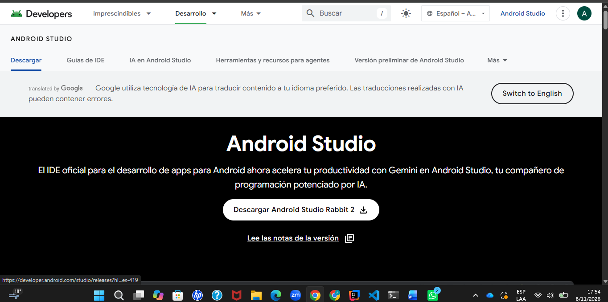
2. Ejecute el instalador (`.exe`), deje marcadas las opciones por defecto (Android Studio y Android Virtual Device) y presione **Next** hasta finalizar.
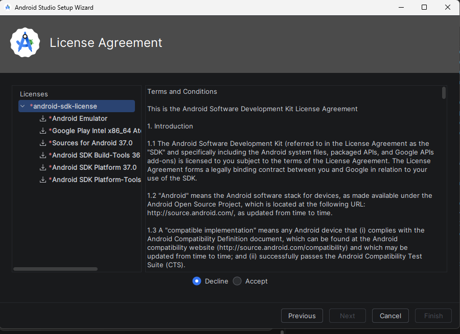
3. Al abrirlo por primera vez, elija **Standard** en el asistente de configuración y acepte las licencias del SDK.
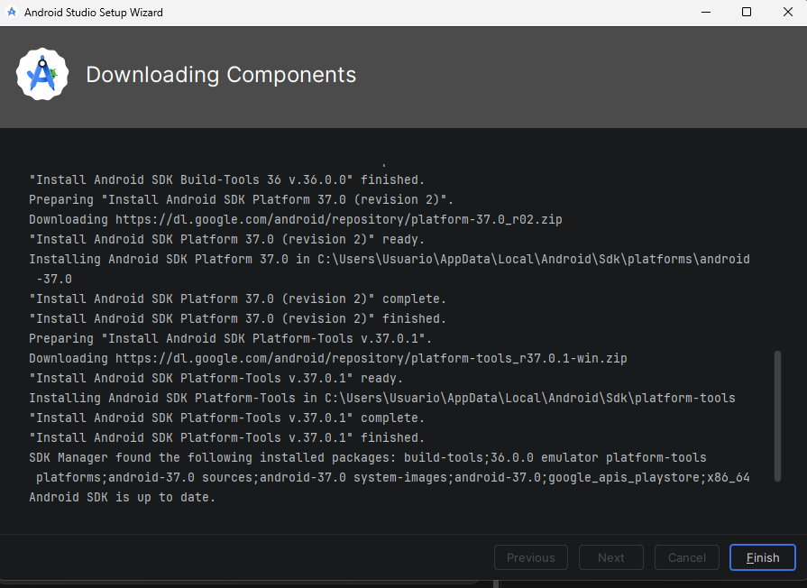
4. Espere a que se descarguen el SDK, las herramientas y el emulador. Puede tardar varios minutos.
5. Verifique el SDK en **More Actions → SDK Manager** (o **Tools → SDK Manager**): debe estar marcado como instalado **Android 17.0 (API 37)**, la plataforma que descarga el asistente.
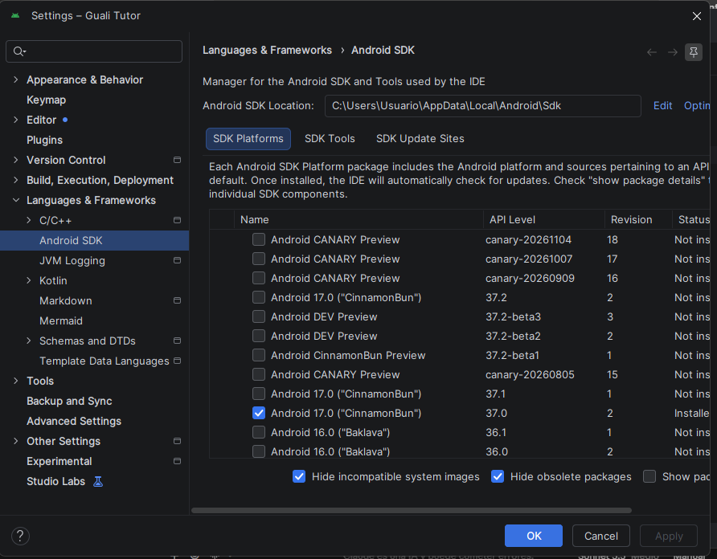

## 4. Crear el proyecto

1. En la pantalla de bienvenida presione **New Project**.
2. Seleccione la plantilla **Empty Views Activity** (no *Empty Activity*, que usa Compose) y presione **Next**.
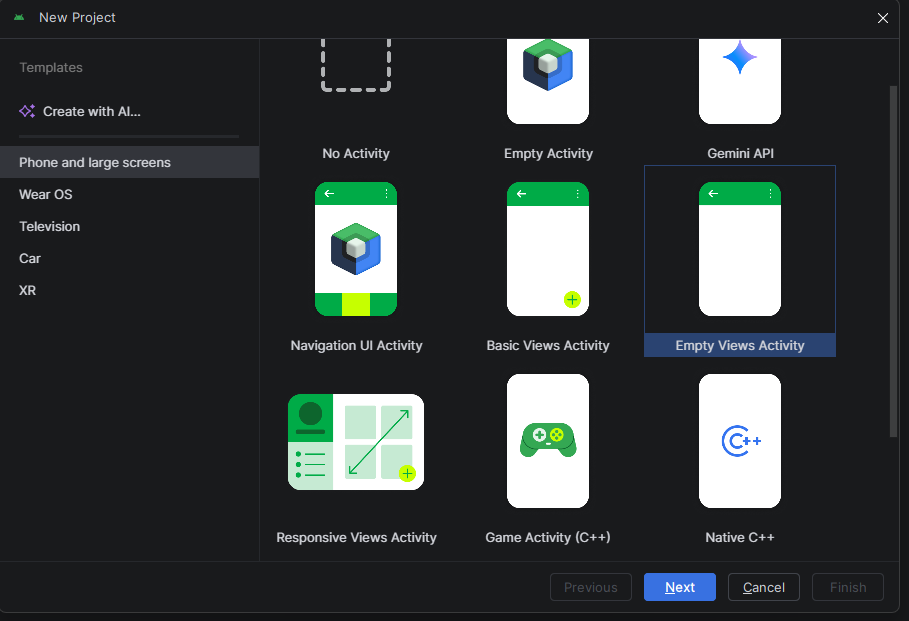
3. Configure el proyecto con estos valores y presione **Finish**:

| Campo | Valor |
|---|---|
| Name | `Guali Tutor` |
| Package name | `com.guali.tutor` |
| Save location | La carpeta de su preferencia |
| Language | **Java** |
| Minimum SDK | API 24 (Android 7.0) |
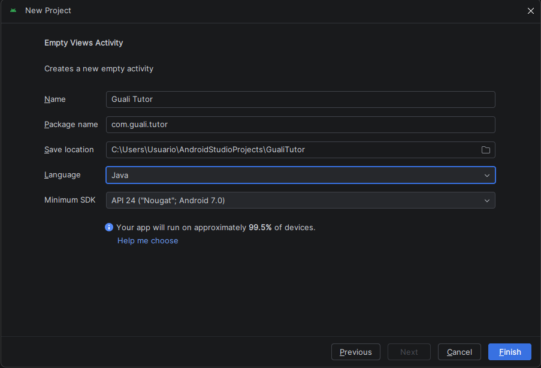
4. Espere a que Gradle sincronice el proyecto (barra de progreso inferior). La primera vez descarga dependencias.
5. En el panel **Project** (vista *Android*) verá `app/java/com.guali.tutor/MainActivity` y `app/res`.
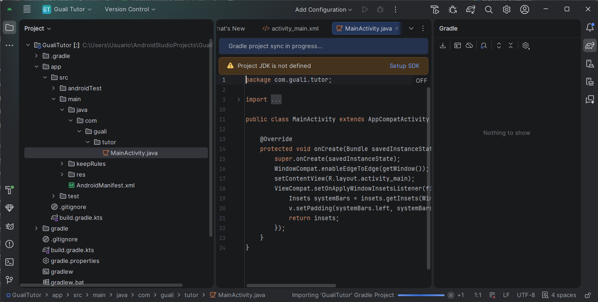

> La plantilla ya incluye las dependencias `appcompat` y `material` en `app/build.gradle.kts`, que son las que usa esta interfaz. No hace falta agregar nada.

> Mientras Gradle sincroniza puede aparecer el aviso **Project JDK is not defined**. Es normal: desaparece al terminar la sincronización. Si persiste, presione **Setup SDK** y elija el JDK incluido en Android Studio.

## 5. Textos, colores y tema

Los textos van en `strings.xml` para no escribirlos directamente en el diseño.

**5.1 Textos.** Abra `app/res/values/strings.xml` y reemplace todo su contenido por:

```xml
<resources>
    <string name="app_name">Guali Tutor</string>
    <string name="menu_lecciones">Lecciones</string>
    <string name="menu_configuracion">Configuración</string>
    <string name="menu_historial">Historial</string>
    <string name="menu_ayuda">Ayuda</string>
    <string name="etiqueta_leccion_activa">LECCIÓN ACTIVA</string>
    <string name="titulo_leccion_activa">leccion-01-hola-mundo</string>
    <string name="descripcion_imagen_leccion">Imagen de la lección activa</string>
    <string name="descripcion_leccion">Descripción de la lección activa.\n\nPaso 1: Hola Mundo\n\nEn base al código en pantalla, crea una versión que imprima primero \"Hola\" y luego en una nueva línea \"Guali con Java 25!\".\n\nRecuerde que el código debe compilar correctamente. El botón Ejecutar validará su resultado.</string>
    <string name="hint_editor">Escriba aquí su código Java</string>
    <string name="boton_compilar">Compilar</string>
    <string name="boton_ejecutar">Ejecutar</string>
    <string name="consola_inicial">[Consola] Listo. Escriba código y presione Compilar.</string>
    <string name="consola_editor_vacio">[Compilar] Error: el editor de código está vacío.</string>
    <string name="consola_compilacion_exitosa">[Compilar] Compilación exitosa. Ya puede presionar Ejecutar.</string>
    <string name="consola_ejecutando">[Ejecutar] Ejecutando el programa…</string>
    <string name="consola_resultado">[Ejecutar] Ejecución finalizada.</string>
    <string name="consola_menu">[Menú] Opción seleccionada: %1$s</string>
</resources>
```
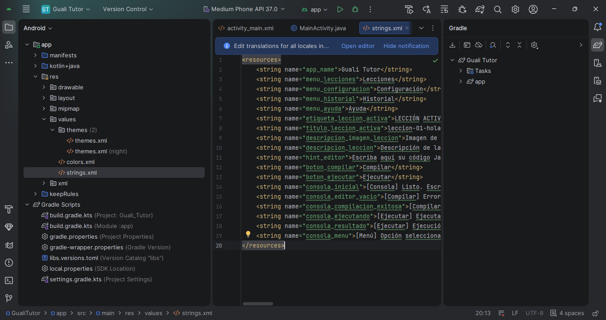

**5.2 Colores.** Abra `app/res/values/colors.xml` y reemplácelo por:

```xml
<?xml version="1.0" encoding="utf-8"?>
<resources>
    <color name="negro">#FF000000</color>
    <color name="blanco">#FFFFFFFF</color>
    <color name="gris_borde">#FF9E9E9E</color>
    <color name="gris_fondo">#FFF2F4F8</color>
    <color name="azul_borde">#FF2196F3</color>
    <color name="verde_boton">#FF5CA832</color>
    <color name="gris_boton">#FF8A8F98</color>
    <color name="consola_fondo">#FF1E1E1E</color>
    <color name="consola_texto">#FFE0E0E0</color>
</resources>
```

**5.3 Color del botón Ejecutar.** Para que el botón se vea gris cuando está deshabilitado, clic derecho sobre la carpeta `res` → **New → Android Resource File**, con File name `tinte_ejecutar`, Resource type **Color** y Root element `selector`. Reemplace su contenido por:

```xml
<?xml version="1.0" encoding="utf-8"?>
<selector xmlns:android="http://schemas.android.com/apk/res/android">
    <item android:state_enabled="false" android:color="#FFBDBDBD" />
    <item android:color="@color/verde_boton" />
</selector>
```

**5.4 Tema.** Abra `app/res/values/themes.xml` y reemplácelo por:

```xml
<resources>
    <style name="Theme.GualiTutor" parent="Theme.MaterialComponents.Light.NoActionBar">
        <item name="colorPrimary">@color/negro</item>
        <item name="colorOnPrimary">@color/blanco</item>
        <item name="colorSecondary">@color/verde_boton</item>
    </style>
</resources>
```

Si existe la carpeta `app/res/values-night` con otro `themes.xml`, elimínela (clic derecho → **Delete**) para que la app use siempre este tema claro.

El tema usa `NoActionBar` porque la barra de menú de la interfaz la dibujamos nosotros mismos en el diseño.
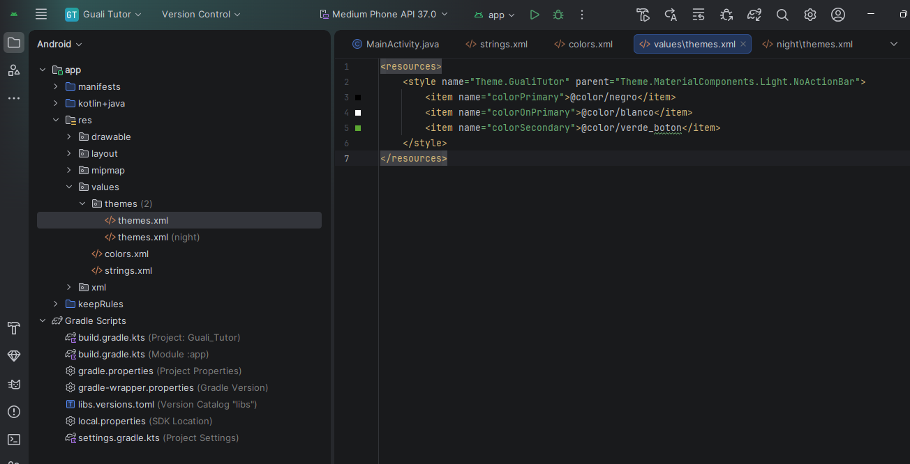

## 6. Recursos gráficos (drawables)

Cree los siguientes archivos en `app/res/drawable` (clic derecho sobre `drawable` → **New → Drawable Resource File**, escriba el nombre sin extensión y reemplace el contenido).
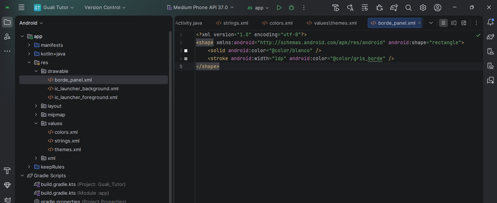

**`borde_panel.xml`** – fondo blanco con borde gris para los paneles y el editor:

```xml
<?xml version="1.0" encoding="utf-8"?>
<shape xmlns:android="http://schemas.android.com/apk/res/android" android:shape="rectangle">
    <solid android:color="@color/blanco" />
    <stroke android:width="1dp" android:color="@color/gris_borde" />
</shape>
```

**`borde_titulo.xml`** – borde azul para el título de la lección:

```xml
<?xml version="1.0" encoding="utf-8"?>
<shape xmlns:android="http://schemas.android.com/apk/res/android" android:shape="rectangle">
    <solid android:color="@color/blanco" />
    <stroke android:width="1dp" android:color="@color/azul_borde" />
</shape>
```

**`fondo_consola.xml`** – fondo oscuro con borde azul para la consola:

```xml
<?xml version="1.0" encoding="utf-8"?>
<shape xmlns:android="http://schemas.android.com/apk/res/android" android:shape="rectangle">
    <solid android:color="@color/consola_fondo" />
    <stroke android:width="1dp" android:color="@color/azul_borde" />
</shape>
```

**`ic_leccion.xml`** – imagen de ejemplo (un paisaje) que ocupa el lugar de la imagen de la lección:

```xml
<?xml version="1.0" encoding="utf-8"?>
<vector xmlns:android="http://schemas.android.com/apk/res/android"
    android:width="96dp"
    android:height="96dp"
    android:viewportWidth="96"
    android:viewportHeight="96">
    <path
        android:fillColor="#FF6B7390"
        android:pathData="M48,28m-8,0a8,8 0,1 1,16 0a8,8 0,1 1,-16 0" />
    <path
        android:fillColor="#FF6B7390"
        android:pathData="M10,76L38,40L54,60L64,48L86,76Z" />
</vector>
```

## 7. Diseño de la interfaz (activity_main.xml)

Abra `app/res/layout/activity_main.xml`. Cambie a la vista **Code** (arriba a la derecha) y reemplace todo el contenido por el diseño completo que se muestra al final de esta sección. Antes se explica cada área.

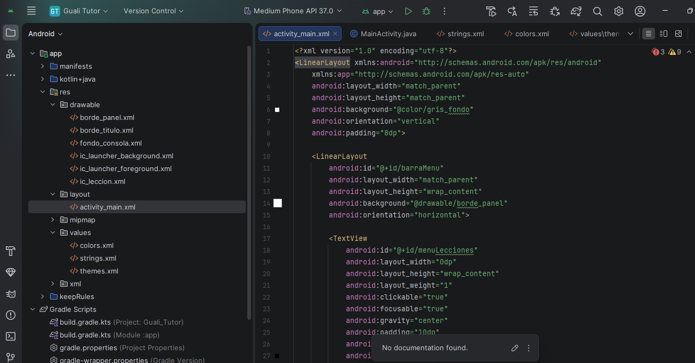

El contenedor raíz es un `LinearLayout` vertical. Las áreas que deben crecer (panel de lección, editor y consola) usan `layout_height="0dp"` con `layout_weight`, de modo que se reparten el espacio disponible; la barra de menú, el título y los botones solo ocupan lo necesario.

1. **Barra de menú (`barraMenu`).** Un `LinearLayout` horizontal con cuatro `TextView` de igual ancho (`layout_weight="1"`) y `clickable="true"`: Lecciones, Configuración, Historial y Ayuda.
2. **Título de lección activa.** Otro `LinearLayout` horizontal con la etiqueta negra "LECCIÓN ACTIVA" (`etiquetaLeccionActiva`) y el nombre de la lección (`tituloLeccionActiva`), con borde azul.
3. **Panel de lección activa (`panelLeccionActiva`).** Un `LinearLayout` vertical con un `ImageView` (la imagen de la lección) y un `ScrollView` con la descripción, para que el texto largo se pueda desplazar.
4. **Editor de código (`editorCodigo`).** Un `EditText` multilínea (`inputType="textMultiLine"`), con tipografía monoespaciada y el texto alineado arriba (`gravity="top|start"`).
5. **Botones de acción (`botonesAccion`).** Dos `MaterialButton` centrados: `botonCompilar` y `botonEjecutar`. Este último inicia deshabilitado con `android:enabled="false"`.
6. **Panel de consola (`panelConsola`).** Un `TextView` monoespaciado de texto claro sobre fondo oscuro, dentro de un `ScrollView` (`scrollConsola`) para que la salida se pueda recorrer.

Código completo:

```xml
<?xml version="1.0" encoding="utf-8"?>
<LinearLayout xmlns:android="http://schemas.android.com/apk/res/android"
    xmlns:app="http://schemas.android.com/apk/res-auto"
    android:layout_width="match_parent"
    android:layout_height="match_parent"
    android:background="@color/gris_fondo"
    android:orientation="vertical"
    android:padding="8dp">

    <LinearLayout
        android:id="@+id/barraMenu"
        android:layout_width="match_parent"
        android:layout_height="wrap_content"
        android:background="@drawable/borde_panel"
        android:orientation="horizontal">

        <TextView
            android:id="@+id/menuLecciones"
            android:layout_width="0dp"
            android:layout_height="wrap_content"
            android:layout_weight="1"
            android:clickable="true"
            android:focusable="true"
            android:gravity="center"
            android:minHeight="48dp"
            android:paddingHorizontal="2dp"
            android:paddingVertical="10dp"
            android:text="@string/menu_lecciones"
            android:textColor="@color/negro"
            android:textSize="13sp" />

        <TextView
            android:id="@+id/menuConfiguracion"
            android:layout_width="0dp"
            android:layout_height="wrap_content"
            android:layout_weight="1"
            android:clickable="true"
            android:focusable="true"
            android:gravity="center"
            android:minHeight="48dp"
            android:paddingHorizontal="2dp"
            android:paddingVertical="10dp"
            android:text="@string/menu_configuracion"
            android:textColor="@color/negro"
            android:textSize="13sp" />

        <TextView
            android:id="@+id/menuHistorial"
            android:layout_width="0dp"
            android:layout_height="wrap_content"
            android:layout_weight="1"
            android:clickable="true"
            android:focusable="true"
            android:gravity="center"
            android:minHeight="48dp"
            android:paddingHorizontal="2dp"
            android:paddingVertical="10dp"
            android:text="@string/menu_historial"
            android:textColor="@color/negro"
            android:textSize="13sp" />

        <TextView
            android:id="@+id/menuAyuda"
            android:layout_width="0dp"
            android:layout_height="wrap_content"
            android:layout_weight="1"
            android:clickable="true"
            android:focusable="true"
            android:gravity="center"
            android:minHeight="48dp"
            android:paddingHorizontal="2dp"
            android:paddingVertical="10dp"
            android:text="@string/menu_ayuda"
            android:textColor="@color/negro"
            android:textSize="13sp" />
    </LinearLayout>

    <LinearLayout
        android:layout_width="match_parent"
        android:layout_height="wrap_content"
        android:layout_marginTop="6dp"
        android:orientation="horizontal">

        <TextView
            android:id="@+id/etiquetaLeccionActiva"
            android:layout_width="wrap_content"
            android:layout_height="match_parent"
            android:background="@color/negro"
            android:gravity="center"
            android:paddingStart="12dp"
            android:paddingEnd="12dp"
            android:text="@string/etiqueta_leccion_activa"
            android:textColor="@color/blanco"
            android:textSize="11sp"
            android:textStyle="bold" />

        <TextView
            android:id="@+id/tituloLeccionActiva"
            android:layout_width="0dp"
            android:layout_height="wrap_content"
            android:layout_weight="1"
            android:background="@drawable/borde_titulo"
            android:gravity="center_vertical"
            android:paddingStart="10dp"
            android:paddingTop="8dp"
            android:paddingEnd="10dp"
            android:paddingBottom="8dp"
            android:singleLine="true"
            android:text="@string/titulo_leccion_activa"
            android:textColor="@color/negro"
            android:textSize="13sp" />
    </LinearLayout>

    <LinearLayout
        android:id="@+id/panelLeccionActiva"
        android:layout_width="match_parent"
        android:layout_height="0dp"
        android:layout_marginTop="6dp"
        android:layout_weight="1.2"
        android:background="@drawable/borde_panel"
        android:orientation="vertical"
        android:padding="6dp">

        <ImageView
            android:id="@+id/imagenLeccion"
            android:layout_width="match_parent"
            android:layout_height="90dp"
            android:background="@color/gris_fondo"
            android:contentDescription="@string/descripcion_imagen_leccion"
            android:scaleType="centerInside"
            android:src="@drawable/ic_leccion" />

        <ScrollView
            android:layout_width="match_parent"
            android:layout_height="0dp"
            android:layout_marginTop="6dp"
            android:layout_weight="1"
            android:background="@drawable/borde_panel">

            <TextView
                android:id="@+id/descripcionLeccion"
                android:layout_width="match_parent"
                android:layout_height="wrap_content"
                android:padding="8dp"
                android:text="@string/descripcion_leccion"
                android:textColor="@color/negro"
                android:textSize="13sp" />
        </ScrollView>
    </LinearLayout>

    <EditText
        android:id="@+id/editorCodigo"
        android:layout_width="match_parent"
        android:layout_height="0dp"
        android:layout_marginTop="6dp"
        android:layout_weight="1.2"
        android:background="@drawable/borde_panel"
        android:gravity="top|start"
        android:hint="@string/hint_editor"
        android:importantForAutofill="no"
        android:inputType="textMultiLine|textNoSuggestions"
        android:padding="8dp"
        android:textColor="@color/negro"
        android:textSize="13sp"
        android:typeface="monospace" />

    <LinearLayout
        android:id="@+id/botonesAccion"
        android:layout_width="match_parent"
        android:layout_height="wrap_content"
        android:layout_marginTop="6dp"
        android:gravity="center"
        android:orientation="horizontal">

        <com.google.android.material.button.MaterialButton
            android:id="@+id/botonCompilar"
            android:layout_width="wrap_content"
            android:layout_height="wrap_content"
            android:text="@string/boton_compilar"
            app:backgroundTint="@color/gris_boton" />

        <com.google.android.material.button.MaterialButton
            android:id="@+id/botonEjecutar"
            android:layout_width="wrap_content"
            android:layout_height="wrap_content"
            android:layout_marginStart="12dp"
            android:enabled="false"
            android:text="@string/boton_ejecutar"
            app:backgroundTint="@color/tinte_ejecutar" />
    </LinearLayout>

    <ScrollView
        android:id="@+id/scrollConsola"
        android:layout_width="match_parent"
        android:layout_height="0dp"
        android:layout_marginTop="6dp"
        android:layout_weight="0.8"
        android:background="@drawable/fondo_consola">

        <TextView
            android:id="@+id/panelConsola"
            android:layout_width="match_parent"
            android:layout_height="wrap_content"
            android:padding="8dp"
            android:text="@string/consola_inicial"
            android:textColor="@color/consola_texto"
            android:textSize="12sp"
            android:typeface="monospace" />
    </ScrollView>

</LinearLayout>
```

Cambie a la vista **Design** para ver la vista previa y comprobar que los seis elementos aparecen como en el boceto.
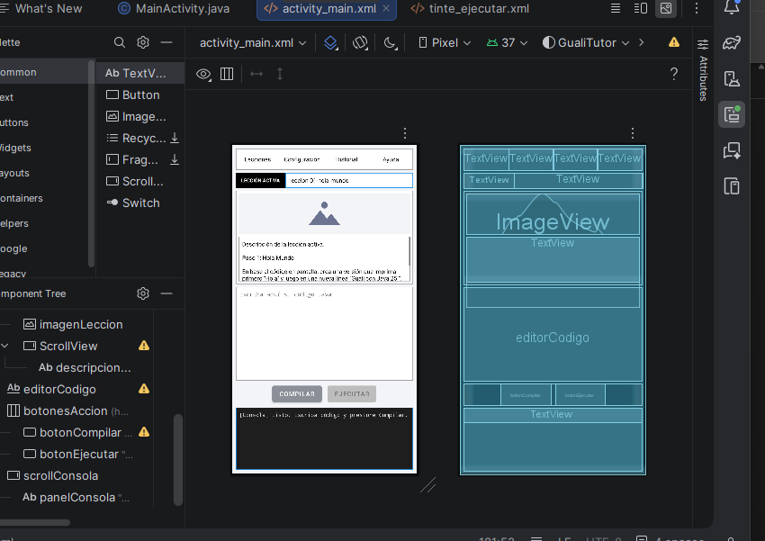

## 8. Lógica de la pantalla (MainActivity.java)

Abra `app/java/com.guali.tutor/MainActivity.java` y reemplace su contenido por:

```java
package com.guali.tutor;

import android.os.Bundle;
import android.text.Editable;
import android.text.TextWatcher;
import android.view.View;
import android.widget.EditText;
import android.widget.ScrollView;
import android.widget.TextView;

import androidx.appcompat.app.AppCompatActivity;

import com.google.android.material.button.MaterialButton;

public class MainActivity extends AppCompatActivity {

    private EditText editorCodigo;
    private TextView panelConsola;
    private ScrollView scrollConsola;
    private MaterialButton botonCompilar;
    private MaterialButton botonEjecutar;

    @Override
    protected void onCreate(Bundle savedInstanceState) {
        super.onCreate(savedInstanceState);
        setContentView(R.layout.activity_main);

        editorCodigo = findViewById(R.id.editorCodigo);
        panelConsola = findViewById(R.id.panelConsola);
        scrollConsola = findViewById(R.id.scrollConsola);
        botonCompilar = findViewById(R.id.botonCompilar);
        botonEjecutar = findViewById(R.id.botonEjecutar);

        configurarMenu();
        configurarEditor();
        configurarBotones();
    }

    private void configurarMenu() {
        asignarOpcionMenu(R.id.menuLecciones, R.string.menu_lecciones);
        asignarOpcionMenu(R.id.menuConfiguracion, R.string.menu_configuracion);
        asignarOpcionMenu(R.id.menuHistorial, R.string.menu_historial);
        asignarOpcionMenu(R.id.menuAyuda, R.string.menu_ayuda);
    }

    private void asignarOpcionMenu(int idVista, int idTexto) {
        View opcion = findViewById(idVista);
        opcion.setOnClickListener(v -> escribirEnConsola(getString(R.string.consola_menu, getString(idTexto))));
    }

    private void configurarEditor() {
        editorCodigo.addTextChangedListener(new TextWatcher() {
            @Override
            public void beforeTextChanged(CharSequence s, int start, int count, int after) {
            }

            @Override
            public void onTextChanged(CharSequence s, int start, int before, int count) {
                botonEjecutar.setEnabled(false);
            }

            @Override
            public void afterTextChanged(Editable s) {
            }
        });
    }

    private void configurarBotones() {
        botonCompilar.setOnClickListener(v -> compilar());
        botonEjecutar.setOnClickListener(v -> ejecutar());
    }

    private void compilar() {
        String codigo = editorCodigo.getText().toString().trim();
        if (codigo.isEmpty()) {
            botonEjecutar.setEnabled(false);
            escribirEnConsola(getString(R.string.consola_editor_vacio));
            return;
        }
        botonEjecutar.setEnabled(true);
        escribirEnConsola(getString(R.string.consola_compilacion_exitosa));
    }

    private void ejecutar() {
        escribirEnConsola(getString(R.string.consola_ejecutando));
        escribirEnConsola(getString(R.string.consola_resultado));
    }

    private void escribirEnConsola(String mensaje) {
        panelConsola.append("\n" + mensaje);
        scrollConsola.post(() -> scrollConsola.fullScroll(View.FOCUS_DOWN));
    }
}
```

Qué hace cada parte:

- `onCreate` carga el diseño, obtiene las referencias a las vistas con `findViewById` y configura el menú, el editor y los botones.
- `configurarMenu` hace que cada opción de la barra de menú escriba en la consola la opción elegida.
- `configurarEditor` agrega un `TextWatcher`: cuando el usuario cambia el código, **Ejecutar** se deshabilita porque ya no corresponde a la última compilación.
- `compilar` revisa el editor: si está vacío muestra un error y deja **Ejecutar** deshabilitado; si tiene contenido informa la compilación exitosa y habilita **Ejecutar**.
- `ejecutar` escribe en la consola el inicio y el fin de la ejecución.
- `escribirEnConsola` agrega una línea al panel y desplaza el `ScrollView` hasta el final.
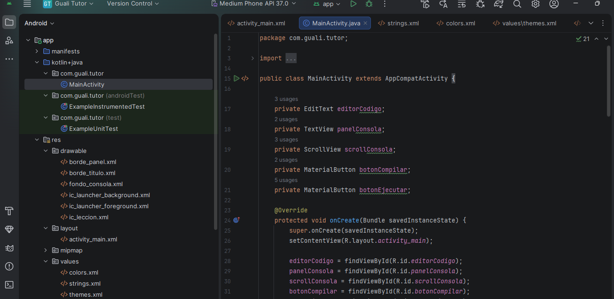

## 9. Crear el emulador y ejecutar

1. Abra **Tools → Device Manager** y presione **Create Virtual Device** (o el botón **+**).
2. Elija un dispositivo, por ejemplo **Pixel 6**, y presione **Next**.
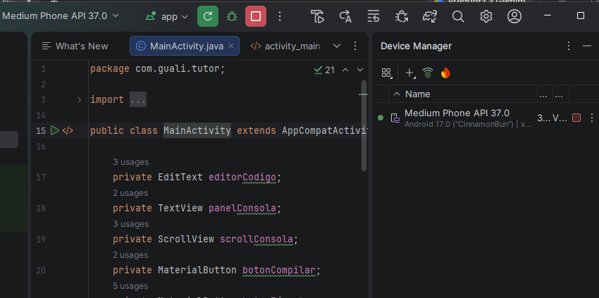
3. Seleccione la imagen de sistema **API 37** (presione **Download** si aún no está) y finalice el asistente. Si ya aparece un dispositivo como **Medium Phone API 37.0**, puede usarlo directamente.
4. En la barra superior elija ese dispositivo y presione el botón verde **Run 'app'** (▶).
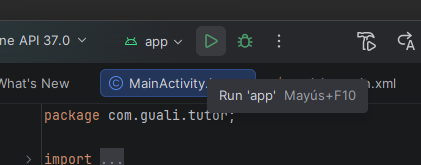
5. Espere a que el emulador arranque e instale la aplicación.

Si prefiere un teléfono físico: active **Opciones de desarrollador → Depuración USB**, conéctelo por cable y selecciónelo en la misma lista de dispositivos.

## 10. Probar la interfaz

1. Con el editor vacío, presione **Compilar**: la consola muestra el error del editor vacío y **Ejecutar** sigue deshabilitado.
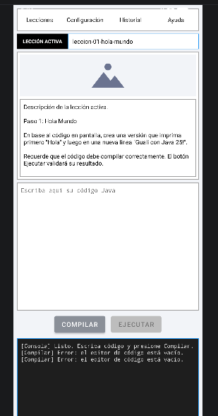
2. Escriba código en el editor, por ejemplo:
   ```java
   void main() {
       IO.println("Hola");
       IO.println("Guali con Java 25!");
   }
   ```
   y presione **Compilar**: la consola informa la compilación exitosa y **Ejecutar** se habilita.
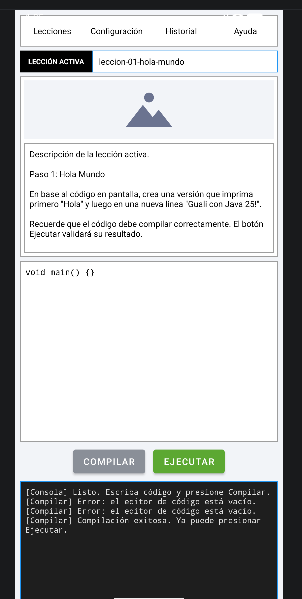
3. Presione **Ejecutar**: la consola muestra el mensaje de ejecución.
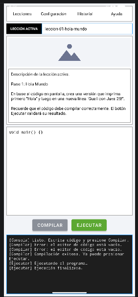
4. Modifique el código: **Ejecutar** vuelve a deshabilitarse hasta compilar de nuevo.
5. Toque las opciones del menú (Lecciones, Configuración, Historial, Ayuda): la consola indica cuál se seleccionó.
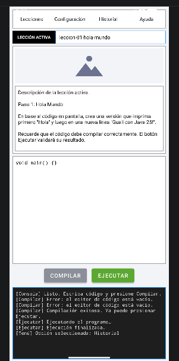

## 11. Estructura final del proyecto

```
GualiTutor/
├── build.gradle.kts
├── settings.gradle.kts
├── gradle.properties
├── gradle/wrapper/gradle-wrapper.properties
└── app/
    ├── build.gradle.kts
    └── src/main/
        ├── AndroidManifest.xml
        ├── java/com/guali/tutor/MainActivity.java
        └── res/
            ├── layout/activity_main.xml
            ├── color/ (tinte_ejecutar)
            ├── drawable/ (borde_panel, borde_titulo, fondo_consola, ic_leccion)
            └── values/ (strings, colors, themes)
```

El proyecto completo con este código está en este mismo repositorio y se abre directamente con **File → Open** en Android Studio.
